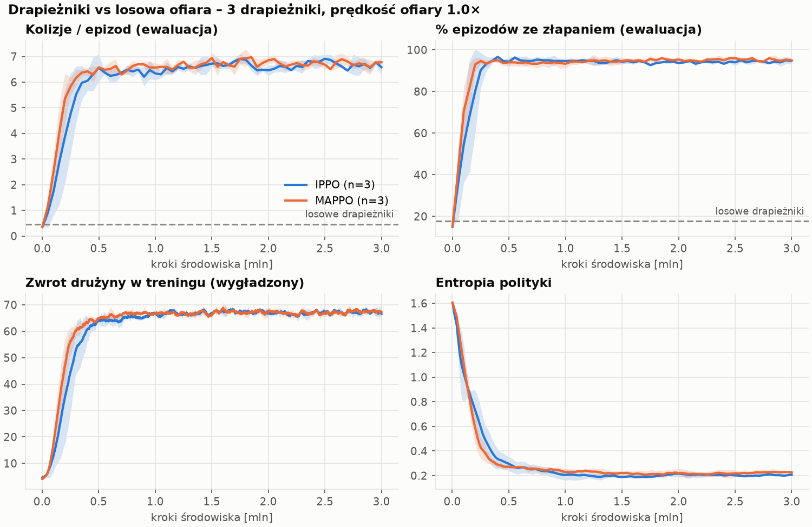
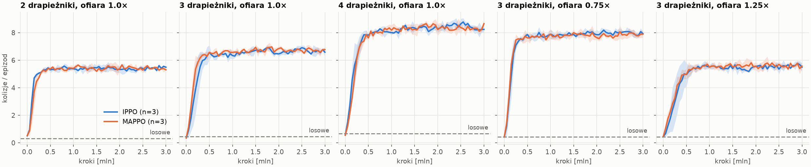
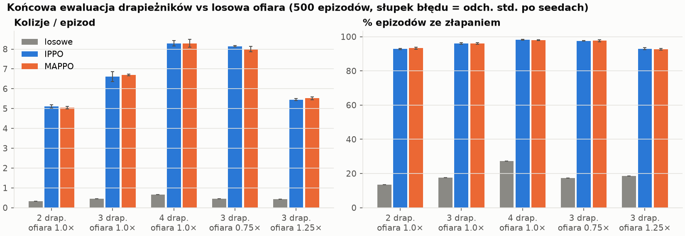
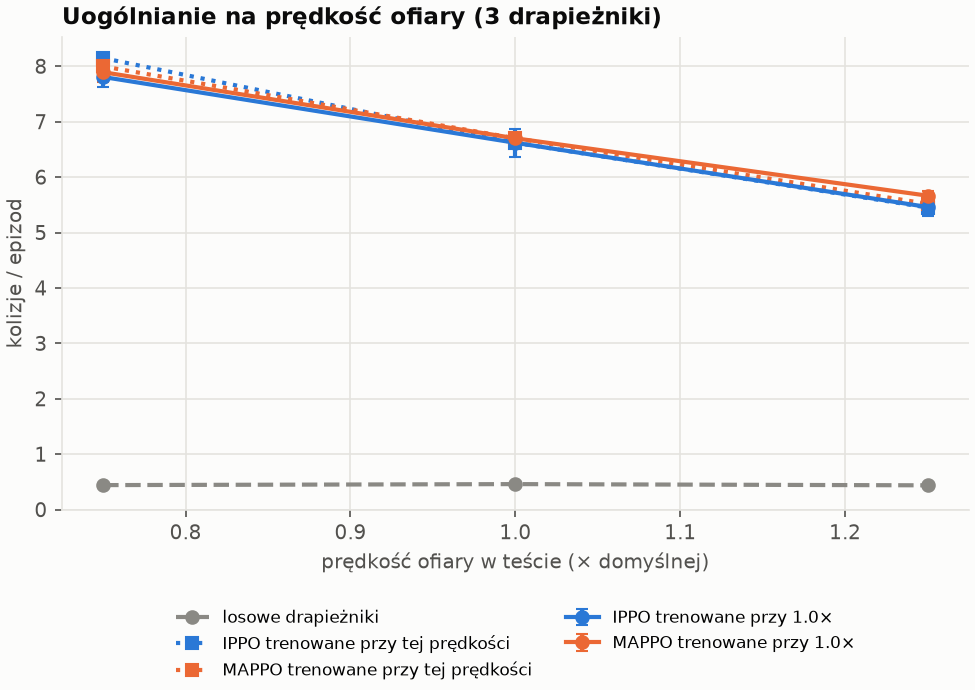
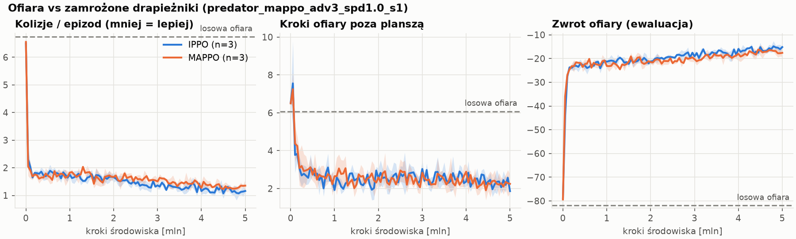

# Punkt kontrolny 2 – MPE2 Simple Tag (zespół 18)

Stan projektu na 18.11.2026. Wszystkie liczby pochodzą z `results/trained_eval.csv` i `results/summary.md`,
wykresy – z `results/*.png` (generowane przez `run_experiments.py` / `plot_results.py`).

## W skrócie

- **Własna implementacja PPO w PyTorch** w dwóch wariantach – **IPPO** (krytyk `V(o_i)`) i **MAPPO**
  (krytyk `V(s)`, CTDE) – ze współdzieleniem parametrów w drużynie (`ppo.py`).
- **Podejście sekwencyjne:** (1) drapieżniki uczą się przeciw losowej ofierze, (2) najlepsze drapieżniki
  są zamrażane i przeciw nim uczy się ofiara.
- **36 treningów** w jedną noc (30 drapieżników + 6 ofiar, po 3 seedy), ~3 h 50 min na 6-rdzeniowym CPU.
- **Wyuczona polityka jest wyraźnie lepsza od losowej:** w konfiguracji domyślnej drapieżniki mają
  **6.7 kolizji / epizod i 96% epizodów ze złapaniem** (losowe: 0.46 i 17.6%).
- **Wyuczona ofiara** przeciw zamrożonym drapieżnikom: **1.2–1.3 kolizji / epizod i ~50% złapań**
  (losowa ofiara przeciw tym samym drapieżnikom: 6.7 i 96%).
- **IPPO ≈ MAPPO** we wszystkich konfiguracjach (różnice w granicach rozrzutu między seedami) –
  losowa ofiara jest zbyt łatwa, by scentralizowany krytyk dawał przewagę. To główna obserwacja
  na kolejny etap.

## Realizacja wymagań punktu kontrolnego

| Wymaganie | Gdzie |
|---|---|
| Działająca implementacja i przebieg treningu | `ppo.py`, `run_experiments.py`; logi w `runs/*/log.csv`, `stdout.log` |
| Wyuczona polityka (nie losowa) | tabele poniżej, `demo.py` (na żywo: losowe vs wytrenowane), `record_agents.py` |
| Krzywe uczenia | `results/learning_curves_default.png`, `learning_curves_variants.png`, `learning_curves_prey.png` |
| Metodologia ewaluacji i metryki | sekcja [Metodologia ewaluacji](#metodologia-ewaluacji), `evaluate.py` |
| Porównania dla różnych ustawień środowiska | 2 / 3 / 4 drapieżniki, prędkość ofiary 0.75 / 1.0 / 1.25×; `compare_variants.png`, `speed_generalization.png` |

## Metoda

| Element | Ustawienie |
|---|---|
| Algorytm | PPO (clip 0.2), GAE λ = 0.95, γ = 0.99 |
| Współdzielenie parametrów | jeden aktor i jeden krytyk na drużynę, wejście + one-hot numeru agenta |
| Aktor (IPPO = MAPPO) | MLP 2×128, tanh; wejście: własna obserwacja (16 wym. drapieżnik, 14 ofiara) + id; 5 akcji dyskretnych |
| Krytyk IPPO | `V(o_i)` – własna obserwacja + id |
| Krytyk MAPPO | `V(s)` – konkatenacja obserwacji wszystkich agentów (62 wym. przy 3 drapieżnikach) + id |
| Optymalizacja | Adam, lr 5·10⁻⁴, 10 epok × 4 minibatche, entropia 0.01, przycinanie gradientu 0.5, nagrody × 0.1 |
| Dane na iterację | 16 równoległych środowisk × 125 kroków = 2000 kroków środowiska |
| Koniec epizodu | 25 kroków = obcięcie czasowe, wartość ostatniego stanu bootstrapowana |
| Długość treningu | drapieżniki 3 mln kroków, ofiara 5 mln kroków |
| Przeciwnik | faza 1: polityka losowa; faza 2: zamrożony aktor drapieżników (`final.pt`) |

Jedyną różnicą między IPPO i MAPPO jest wejście krytyka – porównanie jest kontrolowane.

**Checkpointy:** `latest.pt` (pełny stan: wagi, optymalizator, liczniki, generatory losowe – wznowienie
przez `--resume`), `ckpt_<N>k.pt` co 500 tys. kroków (zamrożone stany pośrednie), `best.pt`, `final.pt`.

## Eksperymenty

| Faza | Co | Runy |
|---|---|---|
| 1 | drapieżniki vs losowa ofiara: konfiguracja domyślna (3 drap., ofiara 1.0×), 2 i 4 drapieżniki, ofiara 0.75× i 1.25× | 5 konfiguracji × {IPPO, MAPPO} × 3 seedy = 30 |
| 2 | zamrożenie najlepszych drapieżników z konfiguracji domyślnej i trening ofiary | {IPPO, MAPPO} × 3 seedy = 6 |
| 3 | ewaluacja końcowa wszystkich modeli i wykresy | 111 porównań × 500 epizodów |

Wybór zamrożonych drapieżników (najwięcej kolizji w ostatniej ewaluacji okresowej, 100 epizodów):

| run | kolizje / ep |
|---|---|
| predator_ippo_adv3_spd1.0_s0 | 6.84 |
| predator_ippo_adv3_spd1.0_s1 | 6.65 |
| predator_ippo_adv3_spd1.0_s2 | 6.26 |
| predator_mappo_adv3_spd1.0_s0 | 6.59 |
| **predator_mappo_adv3_spd1.0_s1** | **6.94** ← zamrożony |
| predator_mappo_adv3_spd1.0_s2 | 6.79 |

## Metodologia ewaluacji

- **Ewaluacja okresowa** (krzywe uczenia): co 50 tys. kroków, 100 epizodów.
- **Ewaluacja końcowa:** 500 epizodów na porównanie.
- **Wspólne seedy 10000–10499** dla wszystkich polityk, także losowej – każda polityka startuje
  z tych samych pozycji. Seedy treningowe są z nimi rozłączne.
- Polityka **stochastyczna** (próbkowanie z rozkładu aktora).
- Wynik modelu = średnia z 500 epizodów; między modelami: **średnia ± odch. std. po 3 seedach**.
- **Punkty odniesienia:** losowe drapieżniki vs losowa ofiara (w każdej konfiguracji),
  losowa ofiara vs te same zamrożone drapieżniki (dla fazy 2).

**Metryki:**

| Metryka | Znaczenie |
|---|---|
| kolizje / epizod | suma par (drapieżnik, ofiara) w kontakcie po krokach – główna miara drapieżników (nagroda = 10 × kolizje) |
| % epizodów ze złapaniem | odsetek epizodów z co najmniej jedną kolizją |
| krok 1. złapania | liczony tylko dla epizodów ze złapaniem |
| dystans | średni dystans ofiara–najbliższy drapieżnik |
| kroki poza planszą | kroki, w których ofiara ma \|x\| lub \|y\| > 1 (kara brzegowa) |
| zwroty | zwrot drużyny drapieżników i ofiary |

## Wyniki

### 1. Krzywe uczenia – konfiguracja domyślna



- Oba warianty dochodzą do plateau po ok. **0.5 mln kroków** (kilka minut treningu na pojedynczym procesie).
- MAPPO uczy się nieco szybciej na początku (0.1–0.4 mln kroków), potem krzywe się pokrywają.
- Entropia spada z 1.61 (ln 5, polityka jednostajna) do ~0.2 – polityka staje się prawie deterministyczna.

### 2. Porównanie konfiguracji środowiska





| konfiguracja | losowe: kolizje / ep | losowe: % złapań | IPPO: kolizje / ep | IPPO: % złapań | MAPPO: kolizje / ep | MAPPO: % złapań |
|---|---|---|---|---|---|---|
| 2 drap., ofiara 1.0× | 0.32 | 13.4 | 5.10 ± 0.09 | 92.8 ± 0.3 | 5.04 ± 0.06 | 93.3 ± 0.6 |
| **3 drap., ofiara 1.0×** | 0.46 | 17.6 | 6.62 ± 0.25 | 96.1 ± 0.5 | 6.70 ± 0.04 | 96.1 ± 0.5 |
| 4 drap., ofiara 1.0× | 0.67 | 27.2 | 8.29 ± 0.13 | 98.2 ± 0.2 | 8.29 ± 0.20 | 98.1 ± 0.2 |
| 3 drap., ofiara 0.75× | 0.44 | 17.4 | 8.15 ± 0.04 | 97.6 ± 0.2 | 8.00 ± 0.14 | 97.7 ± 0.6 |
| 3 drap., ofiara 1.25× | 0.44 | 18.6 | 5.45 ± 0.05 | 93.0 ± 0.5 | 5.52 ± 0.07 | 92.6 ± 0.5 |

- Wytrenowane drapieżniki są **12–19× skuteczniejsze** od losowych (kolizje / epizod) w każdej konfiguracji.
- **Liczba drapieżników:** 2 → 3 → 4 daje 5.1 → 6.7 → 8.3 kolizji / epizod.
- **Prędkość ofiary:** 0.75× → 1.0× → 1.25× daje 8.1 → 6.7 → 5.5 kolizji / epizod – szybsza ofiara
  jest trudniejsza, ale nawet przy 1.25× drapieżniki łapią ją w 93% epizodów.

### 3. Uogólnianie na prędkość ofiary

Drapieżniki trenowane przy 1.0× testowane przy innych prędkościach (bez dodatkowego treningu):



| prędkość w teście | IPPO (trening 1.0×) | MAPPO (trening 1.0×) | IPPO (trening przy tej prędkości) | MAPPO (trening przy tej prędkości) |
|---|---|---|---|---|
| 0.75× | 7.81 ± 0.18 | 7.89 ± 0.17 | 8.15 ± 0.04 | 8.00 ± 0.14 |
| 1.0× | 6.62 ± 0.25 | 6.70 ± 0.04 | – | – |
| 1.25× | 5.46 ± 0.15 | 5.66 ± 0.09 | 5.45 ± 0.05 | 5.52 ± 0.07 |

(kolizje / epizod) – polityka z 1.0× uogólnia się prawie bez straty; trening przy docelowej prędkości
daje co najwyżej ~0.3 kolizji / epizod więcej.

### 4. Ofiara przeciw zamrożonym drapieżnikom



| ofiara (vs predator_mappo_adv3_spd1.0_s1) | kolizje / ep | % złapań | krok 1. złapania | dystans | kroki poza planszą |
|---|---|---|---|---|---|
| losowa | 6.74 | 95.8 | 10.7 | 0.331 | 6.1 |
| IPPO | 1.20 ± 0.10 | 48.3 ± 1.1 | 12.0 | 0.408 | 1.9 |
| MAPPO | 1.34 ± 0.12 | 51.8 ± 5.5 | 11.7 | 0.412 | 2.0 |

- Ofiara bardzo szybko (~0.1 mln kroków) uczy się **nie wychodzić poza planszę** (6.1 → ~2 kroki)
  i unikać drapieżników: **5–6× mniej kolizji** niż losowa.
- Po szybkim spadku poprawa jest powolna, ale trwa do końca treningu (5 mln kroków) – trening nie jest
  w pełni zbieżny.
- IPPO i MAPPO dla ofiary dają podobne wyniki – przy jednej ofierze krytyk MAPPO różni się od IPPO
  tylko dodatkową informacją o prędkościach drapieżników.

## Wnioski

1. Implementacja działa i uczy się stabilnie: małe rozrzuty między seedami, plateau po ~0.5 mln kroków.
2. Wyuczone polityki obu drużyn są wyraźnie lepsze od losowych we wszystkich konfiguracjach.
3. Trudność zadania zmienia się zgodnie z oczekiwaniami: więcej drapieżników – łatwiej, szybsza ofiara – trudniej.
4. **Przeciw losowej ofierze MAPPO nie ma przewagi nad IPPO.** Do złapania ofiary, która porusza się
   losowo, wystarczy, że każdy drapieżnik niezależnie biegnie do niej – koordynacja nie jest potrzebna.
   Hipoteza „przewaga MAPPO rośnie, gdy złapanie wymaga współpracy” wymaga trudniejszego przeciwnika.
5. Wyuczona ofiara zmniejsza liczbę kolizji 5–6× – to naturalny „trudny przeciwnik” do dalszych porównań.

## Ograniczenia i uwagi

- 3 seedy na wariant; odch. std. liczone z 3 wartości.
- Krok 1. złapania liczony tylko dla epizodów ze złapaniem – dla losowych drapieżników (8.8) jest
  niższy niż dla wytrenowanych (10.7), prawdopodobnie dlatego, że losowe łapią głównie wtedy, gdy start jest blisko ofiary.
- Zamrożone drapieżniki wybrane na podstawie 100-epizodowej ewaluacji okresowej; różnice między
  kandydatami (6.3–6.9) są niewielkie.
- Trening ofiary nie jest zbieżny po 5 mln kroków.
- Częściowa obserwowalność (zaplanowana trzecia oś trudności) nie została jeszcze zbadana.

## Kolejne kroki

1. **Turniej krzyżowy:** wszystkie drapieżniki IPPO i MAPPO (6 runów) przeciw wytrenowanym ofiarom –
   czy przeciw uciekającej ofierze pojawia się przewaga MAPPO (sama ewaluacja, bez nowego treningu).
2. **Drapieżniki trenowane przeciw zamrożonej wyuczonej ofierze** (kolejny krok sekwencji) –
   porównanie IPPO vs MAPPO przy trudnym przeciwniku.
3. **Częściowa obserwowalność** (`num_agent_neighbors`) jako trzecia oś trudności.
4. **Miary koordynacji:** udział poszczególnych drapieżników w złapaniach, rozłożenie kątowe wokół ofiary.
5. Dłuższy trening ofiary; więcej seedów dla kluczowych porównań.

## Jak odtworzyć

```bash
pip install -r requirements.txt
python run_experiments.py --quick       # test potoku, ~3 min
python run_experiments.py               # wszystkie fazy (~4 h na 6 rdzeniach, 10 procesów)
```

Pokaz (gotowe modele są w [`models/`](../models/README.md), więc nie trzeba trenować):

```bash
# na żywo: losowe drapieżniki (lewa) vs wytrenowane (prawa), te same pozycje startowe
python demo.py --right-pred models/predator_mappo_adv3_spd1.0_s1
# losowa vs wyuczona ofiara przeciw tym samym zamrożonym drapieżnikom
python demo.py --left-pred models/predator_mappo_adv3_spd1.0_s1 --right-pred models/predator_mappo_adv3_spd1.0_s1 \
               --right-prey models/prey_mappo_adv3_spd1.0_vs-predator_mappo_adv3_spd1.0_s1_s0
# trening na żywo, przerwanie (Ctrl+C) i wznowienie
python ppo.py --team predator --algo mappo --total-steps 200000 --run-dir runs/demo
python ppo.py --resume runs/demo --total-steps 300000
# ewaluacja
python evaluate.py --pred models/predator_mappo_adv3_spd1.0_s1 --prey random
```

Szczegóły uruchamiania, checkpointów i plików – w [README](../README.md).

## Wykorzystanie AI

Claude Code (Anthropic) pomagał przy implementacji PPO (IPPO/MAPPO), skryptów eksperymentów, ewaluacji,
wykresów i pokazu na żywo oraz przy przygotowaniu tego podsumowania.
